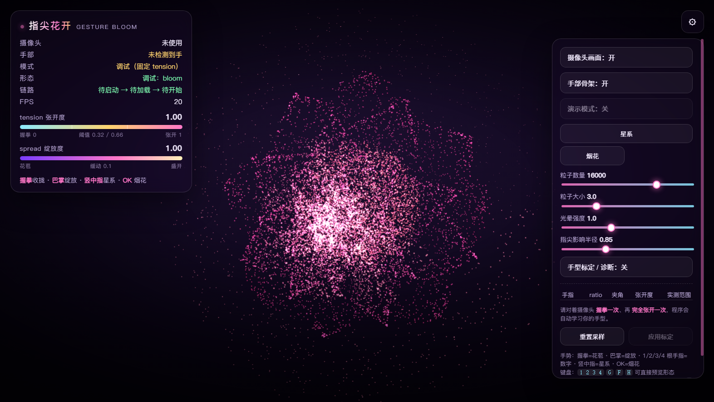

# 指尖花开 · 手势控制粒子形态

用摄像头识别手部 **21 个关键点**，把不同手势映射成粒子形态：
握拳收拢、巴掌绽放（红粉配色的立体花），另有数字 / 星系 / 爱心 / 烟花 / 文字等形态。



---

## 1. 手势对照表

| 手势 | 效果 |
| --- | --- |
| ✊ 握拳 | 粒子收拢成花苞 |
| 🖐 巴掌（五指全开） | 花朵绽放（红粉配色、花瓣层层展开） |
| 1️⃣ 2️⃣ 3️⃣ 4️⃣ | 粒子组成对应数字 |
| 🖕 竖中指 | 银河系 |
| 👌 OK 手势 | 烟花 → 汇聚成文字 |

手势判定带 **4 帧去抖**（`hand.gestureDebounce`），避免手抖误触发。
画面**默认不旋转**（`CONFIG.spin` 全为 0），保证观感稳定。

## 2. 文件结构

```
gesture-flower/
├── index.html    # 页面结构：摄像头层 / 骨架层 / WebGL 层 / HUD / 控制台 / 故障横幅
├── style.css     # 深空霓虹风格 + 响应式
├── gestures.js   # 手部姿态识别（纯函数，可在 Node 里单测）
├── shapes.js     # 粒子形态库（花 / 星系 / 爱心 / 字形 / 烟花）
├── main.js       # 场景、morph 引擎、着色器、状态机、摄像头、主循环
└── preview/      # 效果截图
```

## 3. 本地运行

```bash
cd gesture-flower
python -m http.server 5500
# 打开 http://localhost:5500
```

> ⚠️ 摄像头只允许 **HTTPS** 或 **localhost / 127.0.0.1**。
> 💡 改完代码请 **Ctrl + Shift + R 强制刷新**。

**没有摄像头也能看全部效果**：

| 用法 | 作用 |
| --- | --- |
| `?demo=1` | 演示模式，不申请摄像头 |
| `?shape=bloom` | 直接看某个形态（`bloom` `bud` `galaxy` `heart` `firework`） |
| `?shape=1` ~ `?shape=4` | 数字形态 · `?shape=text` 文字形态 |
| `?tension=0.8` | 固定张开度（0 = 花苞，1 = 全绽放） |
| `?count=3000` | 指定粒子数量 |
| `?calibrate=1` | 展开手型标定面板 |

**键盘**：`G` 星系 · `F` 烟花 · `1~4` 数字 · `空格` 演示模式
**鼠标**：拖拽旋转 · 滚轮缩放 · 双击复位视角

## 4. 花朵的形态与配色

花瓣按**黄金角**（2.39996 rad）螺旋排列，由外到内逐渐变短、变宽、挺立、抬高；
每片花瓣自带拱起 + 碗状弧度 + **外层尖端下翻 / 内层尖端上包**。
**花轴朝相机**（不是平躺着被斜看），所以正面看是饱满的花。

配色是红粉调，`CONFIG` 里对应三个色值：

| 位置 | 色值 | 说明 |
| --- | --- | --- |
| 花心 | `#e01b4c` | 红热（着色器里再叠一层 `vec3(1.0,0.26,0.34)`） |
| 中段 | `#ff4fa3` | 玫红 |
| 边缘 | `#ff8fa8` | 粉红 |

> 早先花心走的是「白热」`vec3(0.85,0.80,0.75)`，会在红粉花里显得突兀，
> 已改成**红热**。星尘闪烁色也从暖白调成了偏红。

## 5. 核心架构：形态引擎

粒子系统只有 **两组位置属性**，却能承载任意多种形态：

```glsl
vec3 p = mix(position, aTarget, morphK);   // 逐粒子错峰的形态插值
```

- 切换形态时，**先用当前 morph 把插值结果烘焙回 `position`**，
  所以任何时刻切换都不会跳变，形态数量也不受 attribute 数量限制；
- 切换时调用 `markAttributesDirty()` **遍历上传所有 attribute** ——
  曾经逐行写漏掉一个，导致 GPU 侧数据不更新、粒子塌缩成一点；
- 相机俯角**按形态自动切换**（`CAM_ELEV`）：花与文字正对观众、星系俯视才有纵深；
- 所有形变都在顶点着色器完成，每帧 CPU 只写十来个 uniform。

## 6. tension（张开度）计算

```
先把坐标等比化：x、z 乘以画面宽高比（否则 MediaPipe 的归一化坐标会被画面比例拉伸）

单指距离比   ratio  = |手腕→指尖| / |手腕→掌指关节|      // 握拳≈0.8，伸直≈1.9
距离指标     oDist  = clamp((ratio - ratioMin) / (ratioMax - ratioMin), 0, 1)
关节夹角     ang    = ∠(MCP, PIP, TIP)                   // 伸直≈175°，握拳≈50°
夹角指标     oAng   = clamp((ang - angleMin) / (angleMax - angleMin), 0, 1)
单指张开度   open_i = 0.65 * oDist + 0.35 * oAng
tension_raw  = Σ(open_i × w_i) / Σ w_i
```

权重：食指 1.15、中指 1.20、无名指 1.10、小指 0.95、**拇指 0.35**。
阈值：`< 0.32` 花苞，`> 0.66` 绽放，中间 smoothstep。
缓动：`currentSpread += (targetSpread - currentSpread) * 0.1`（已做帧率无关化）。

## 7. 手型标定（不同人的手差异很大）

右上角控制台 → 「手型标定 / 诊断」（或 `?calibrate=1`）→ 握拳一次、张开一次 → 应用。
用 **10% / 90% 分位数**抗跳变、再留 2% 余量，**每根手指单独标定**；
拇指活动范围只有其它手指的 1/5，单独放低采样门槛并降权。

## 8. 摄像头不通时不会静默降级

失败会弹出持久横幅（具体原因、检测到几个摄像头、浏览器版本、排查步骤 + 重试按钮）。
HUD 的「链路」一行可看出卡在哪：`已就绪 1280×720 → 已就绪 → 运行中`。

摄像头约束由宽到窄降级：`{facingMode:{ideal:'user'}, 分辨率}` → `{facingMode:{ideal:'user'}}` → `true`。
`facingMode: 'user'`（字符串）是**必需约束**，台式机外接 USB 摄像头会直接抛 `OverconstrainedError`。

## 9. 可调参数速查（`main.js` 顶部 `CONFIG`）

| 参数 | 说明 | 默认 |
| --- | --- | --- |
| `particles.count` | 粒子数量（5000~20000） | 16000 |
| `particles.size` | 粒子直径（CSS 像素） | 3.0 |
| `shape.petals` | 花瓣数（越多越饱满） | 42 |
| `shape.glyphStep` | 字形采样步长（越小笔画越实） | 3 |
| `camera.elevation` | 默认俯角（`CAM_ELEV` 会按形态覆盖） | 38 |
| `hand.gestureDebounce` | 手势需连续稳定帧数 | 4 |

## 10. 常见问题

| 现象 | 解决 |
| --- | --- |
| 文字/数字只有一部分 | 粒子数少于字形点数会稀疏化；调大 `particles.count` 或调小 `glyphStep` |
| 花苞不闭合 | 开标定面板看握拳时的 tension，> 0.32 就做一次实测标定 |
| 花心过白 | 调 `PAL.bloom` 的三个色值，或减少着色器里的红热系数 |
| 帧率低 | 调小 `particles.count`，或降低 `particles.pixelRatioMax` |

